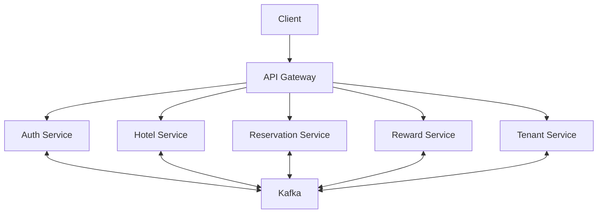

# GuestPlus

GuestPlus is a multi-tenant hotel management SaaS prototype organized as independently deployable Node.js services. The repository uses TypeScript, Express, Prisma, Kafka, and Docker Compose.

## Repository structure

- `api-gateway/`: HTTP entry point for client requests.
- `services/auth-service/`: user authentication, password handling, JWT issuance, and tenant events.
- `services/hotel-service/`: hotel and room domain.
- `services/reservation-service/`: reservation domain.
- `services/reward-service/`: reward domain.
- `services/tenant-service/`: tenant domain and tenant events.
- `docker-compose.yml`: local infrastructure and service orchestration.

## Architecture

## Technology

- Node.js and TypeScript
- Express
- Prisma ORM
- Apache Kafka and Zookeeper
- Docker Compose
- JWT with RS256 keys

## Local development

1. Install Docker and Docker Compose.
2. Review the environment variables required by each service.
3. Configure the database connection strings and JWT key paths for the services.
4. Start the infrastructure and services with `docker compose up --build`.

The Compose file currently mounts service source directories for development. It should not be treated as a production deployment configuration.

## Security notes

- Keep private keys and environment files out of Git.
- Configure short-lived access tokens and a separate refresh-token lifecycle.
- Use unique secrets for each environment.
- Do not expose development infrastructure ports to public networks.

## Project status

This is a work in progress. Review each service's environment requirements and API routes before deploying or integrating it. Automated test coverage and production deployment hardening are still required.
